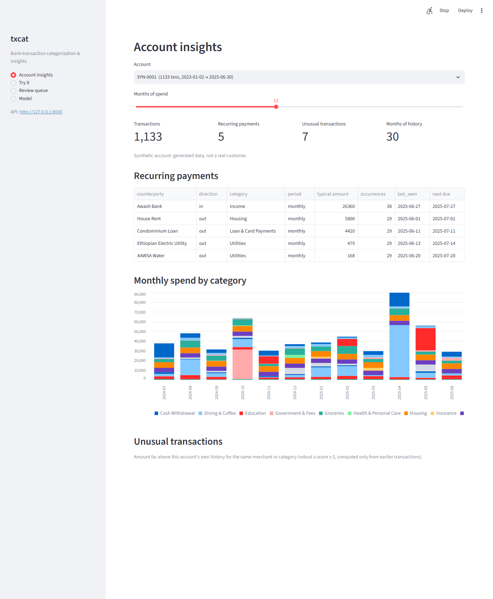
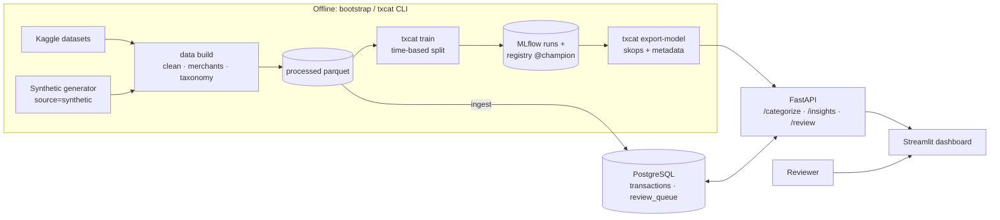
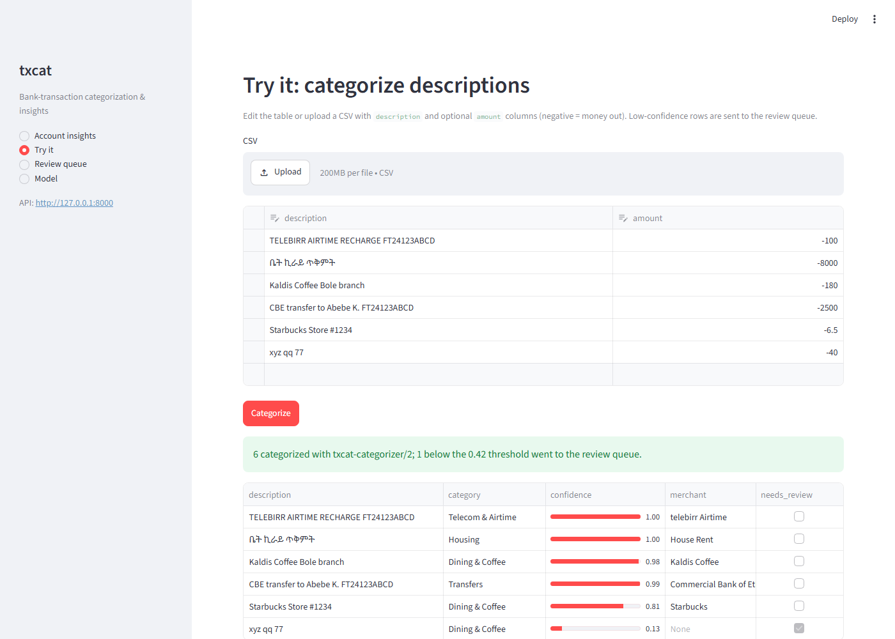
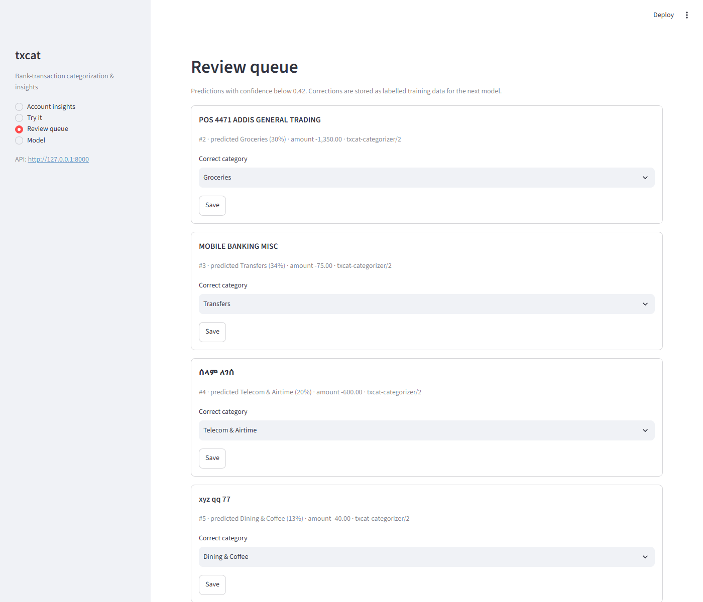
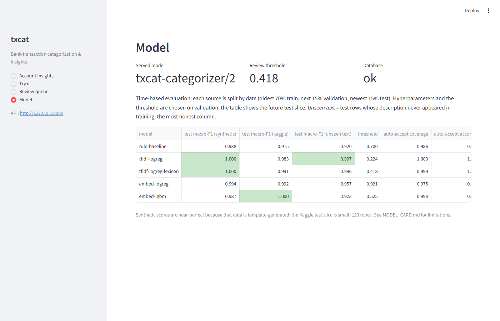

# Transaction Categorization & Financial Insights

[](https://github.com/kidusw/transaction-categorization/actions/workflows/ci.yml)

An end-to-end ML system that reads raw bank-statement lines, in English and
Ethiopian-style mixed Amharic/English (`TELEBIRR AIRTIME FT24123ABCD`, `ቤት ኪራይ ጥቅምት`),
and turns them into categories and insights: recurring payments with their next due
date, monthly spend by category, and unusual transactions. Low-confidence predictions go
to a human review queue, and the corrections become training data.

**Stack:** Python 3.12 · PostgreSQL 16 · SQLAlchemy/Alembic · Pandera · scikit-learn ·
LightGBM · fastembed (ONNX) · MLflow · FastAPI · Streamlit · Docker Compose · GitHub Actions



## At a glance

| | |
|---|---|
| **Data** | 33k synthetic Ethiopian-style transactions (always tagged `source='synthetic'`), 806 real-format Kaggle transactions, 32k Kaggle merchant phrases |
| **Best model** | Word + character n-gram TF-IDF + logistic regression: **0.991 macro-F1** on the future Kaggle slice (rule baseline 0.915) and **0.996** on never-seen descriptions (baseline 0.920) |
| **Evaluation** | Time-based split per source; threshold and hyperparameters picked on validation; separate synthetic / real / unseen-text numbers |
| **Review queue** | Threshold where auto-accepted predictions are ≥97% accurate on each source; 99.9% of test rows are auto-accepted |
| **Insights** | Recurring payments: precision 0.999 / recall 0.976. Anomalies: caught reliably on bills, weak on everyday spend (explained [below](#insights-phase-4)) |
| **Serving** | FastAPI with batch categorization, insights and a review queue; Streamlit dashboard on top of it |

See [MODEL_CARD.md](MODEL_CARD.md) for intended use and limitations, and [PLAN.md](PLAN.md)
for the phased build.

## Architecture



- The API image has no MLflow or training libraries. It loads the exported skops model
  (an allow-listed format, unlike pickle) plus a small JSON sidecar with the version,
  review threshold and model comparison.
- The dashboard only talks to the API over HTTP, so it shows exactly what an API client
  would get.

## Run it

```bash
docker compose up --build
```

On a fresh clone this starts Postgres, then runs a one-shot **bootstrap** container
(migrate → generate the synthetic data → load it → train baseline + TF-IDF → register in
MLflow → export the model to `./models/champion`), then the API and the dashboard:

- Dashboard: <http://localhost:8501>
- API docs: <http://localhost:8000/docs>

Each bootstrap step is skipped when its output already exists, so later `up`s start in
seconds. Set `KAGGLE_API_TOKEN` in your shell first to include the Kaggle data; without
it, only the synthetic data is used.

On a network that intercepts HTTPS (a corporate proxy), the dependency download inside
the build fails with `invalid peer certificate: UnknownIssuer`. Point `TXCAT_CA_BUNDLE`
at a PEM bundle that includes the proxy's root CA. It is passed as a BuildKit secret, only
mounted during `uv sync`, and never copied into the images or the repo:

```bash
TXCAT_CA_BUNDLE=/path/to/ca-bundle.pem docker compose up --build
```

| Image | Contents | Size |
|---|---|---|
| `txcat-api` | FastAPI, scikit-learn, skops, SQLAlchemy (no MLflow) | 871 MB |
| `txcat-dashboard` | Streamlit + httpx | 861 MB |
| `txcat-bootstrap` | + MLflow, LightGBM, Pandera, Kaggle, Faker (runs once) | 1.48 GB |

## Develop locally

```bash
cp .env.example .env            # fill in values; .env is git-ignored
docker compose up -d db         # PostgreSQL 16 on localhost:5433
uv sync                         # all groups: core, train, dashboard, dev
uv run alembic upgrade head     # create tables
uv run txcat data download      # Kaggle sources -> data/raw/kaggle/ (needs KAGGLE_API_TOKEN)
uv run txcat data build --load  # synthetic + clean + merchants -> data/processed/, and Postgres
uv run txcat train              # models -> MLflow (mlflow.db), best one registered
uv run uvicorn txcat.api.app:app --reload          # API on :8000
uv run streamlit run src/txcat/dashboard/app.py    # dashboard on :8501
uv run pytest
```

Optional embedding models (fastembed on ONNX Runtime, no PyTorch; ~240 MB model download
on first use, cached in `data/models/fastembed/`):

```bash
uv sync --extra embeddings
uv run txcat train              # now also trains embed-logreg and embed-lgbm
uv run mlflow ui --backend-store-uri sqlite:///mlflow.db   # browse runs at :5000
```

Command-line insights, and the detectors scored against synthetic ground truth:

```bash
uv run txcat insights show SYN-0003     # recurring payments, monthly spend, anomalies
uv run txcat insights evaluate          # writes reports/insights_evaluation.md
uv run txcat match "CBE transfer to Abebe K. FT24123ABCD" "ቤት ኪራይ ጥቅምት"
```

(On Windows PowerShell, run `[Console]::OutputEncoding = [Text.Encoding]::UTF8;
$env:PYTHONIOENCODING = "utf-8"` first so Amharic prints correctly.)

## Dashboard

| Page | What it shows |
|---|---|
| Account insights | Account picker; recurring payments with next due date; monthly spend by category (stacked bars); unusual transactions |
| Try it | Paste or upload descriptions → category, confidence, merchant; low-confidence rows go to the review queue |
| Review queue | Correct the category of queued predictions; recently reviewed items |
| Model | Served model version, review threshold and the Phase 3 comparison table |





## Data

| Dataset | Rows | What it is | Used for |
|---|---|---|---|
| `synthetic_et` (**synthetic**) | ~33k | Generated Ethiopian-style statements, 30 accounts, Jan 2023 – Jun 2025 | Training/eval, insights |
| [`bukolafatunde/personal-finance`](https://www.kaggle.com/datasets/bukolafatunde/personal-finance) | 806 | Real-format US personal transactions (2018), labelled | Training/eval, insights |
| [`lowlevelexe/malaysian-semantic-transaction-dataset`](https://www.kaggle.com/datasets/lowlevelexe/malaysian-semantic-transaction-dataset) | 32k | Merchant/keyword phrases with categories (no dates/amounts) | Extra training text |

There is no large, public, labelled bank-description dataset, so the synthetic generator
supplies most of the volume. **Synthetic rows are always tagged `source = 'synthetic'`**,
are never presented as real customer data, and metrics will be reported separately per source.

**Synthetic generator** (`txcat.data.synthetic`, seeded and deterministic): each account has
a profile (salary on payday, optional rent, iddir, equb, DStv, loan, utilities) producing
recurring payments, plus Poisson-distributed spending across categories. Descriptions mix
English and Amharic (~40% contain Ge'ez script) with statement-style noise: `FT…` references,
phone numbers, upper-casing, typos. 0.5% of rows are amount spikes flagged
`is_injected_anomaly` for evaluating the anomaly detector.

**Cleaning** (`txcat.data.clean`): NFKC, lower-case, strip references/dates/phone numbers,
keep Ge'ez script. **Merchant normalisation** (`txcat.data.merchants`): rapidfuzz
`token_set_ratio` against a catalog of ~65 merchants and their aliases (English + Amharic).
On synthetic data it gets **97% accuracy at 100% precision**: it would rather return no
merchant than a wrong one.

**Taxonomy** (`txcat.data.taxonomy`): 19 unified categories; every source label maps
explicitly, and an unmapped label fails the build.

## Data contract

Input CSV columns: `account_id`, `date`, `description`, `amount` (signed: negative = money
out), `source` (`kaggle` | `synthetic` | `user`), optional `currency` (ISO-4217, default
`ETB`) and `category`. Rows failing the Pandera schema are rejected with a per-row reason;
the valid rest is loaded idempotently (re-running the same file inserts nothing).

## Models (Phase 3)

All models take the same input (cleaned description + signed amount, used only for
money-in/out direction) and are scikit-learn estimators, so they're evaluated, logged to
MLflow and served the same way.

| Model | What it is |
|---|---|
| `rule-baseline` | Merchant catalog match → category; else English/Amharic keyword rules; else most common class for money in/out |
| `tfidf-logreg` | Word (1–2) + `char_wb` (2–5) n-gram TF-IDF, logistic regression |
| `tfidf-logreg-lexicon` | Same, plus the 32k Kaggle lexicon phrases as extra training text |
| `embed-logreg` / `embed-lgbm` | `paraphrase-multilingual-MiniLM-L12-v2` (quantized ONNX via fastembed, 384-d) + LogReg / LightGBM |

**Evaluation protocol.** Time-based split *per source* (the sources cover different years):
oldest 70% train, next 15% validation, newest 15% test. Hyperparameters and the
review-queue threshold are chosen on validation; test is scored once. Model selection
uses the mean of the synthetic and Kaggle macro-F1, so the 33k synthetic rows can't drown
out the real-format ones. The **unseen text** slice is test rows whose cleaned
description never appears in training.

**Results on the future test slice** (from `reports/model_comparison.md`):

| Model | Macro-F1 all | Synthetic | Kaggle | Unseen text (812 rows) | Review threshold | Auto-accepted | Accuracy of auto-accepted |
|---|---|---|---|---|---|---|---|
| rule-baseline | 0.988 | 0.988 | 0.915 | 0.920 | 0.70 | 98.6% | 99.7% |
| tfidf-logreg | 1.000 | 1.000 | 0.983 | 0.997 | 0.22 | 100% | 100% |
| **tfidf-logreg-lexicon** (registered) | 1.000 | 1.000 | **0.991** | **0.996** | 0.42 | 99.9% | 100% |
| embed-logreg | 0.994 | 0.994 | 0.992 | 0.957 | 0.92 | 97.5% | 99.9% |
| embed-lgbm | 0.988 | 0.987 | 1.000 | 0.923 | 0.53 | 99.8% | 99.5% |

**How to read this honestly:**

- **Synthetic scores are near-perfect because the data is template-generated.** The
  generator draws from a fixed set of merchants and templates, so the future slice
  looks a lot like training. These numbers show the pipeline works; they are not an
  estimate of accuracy on real statements.
- **The Kaggle slice is small (123 test rows) and repetitive.** 121 of its 123 test
  descriptions also appear in training (same merchants every month), so one error moves
  macro-F1 by several points. The 0.91 → 0.99 gain over the baseline is real but noisy.
- **Unseen text is the most informative column.** On descriptions never seen in training
  (mostly new noise variants: typos, references, mixed scripts), character n-gram TF-IDF
  holds at 0.996, while the general-purpose sentence embeddings drop to 0.92–0.96.
  Merchant names and statement noise aren't what those embeddings were trained on.
- **Winner: TF-IDF + LogReg with the lexicon.** It beats the rule baseline on every
  slice, needs no model download, and trains in seconds. It is registered in MLflow as
  `txcat-categorizer@champion` with its review threshold as a version tag.
- **Review queue:** the threshold is the lowest confidence at which auto-accepted
  validation predictions reach 97% accuracy *on each source*. Predictions below it go to
  the review queue (Phase 5).

## Insights (Phase 4)

Unsupervised detectors on an account's history (`txcat.insights`). Transactions are
grouped into **series** per account: counterparty (normalised merchant, falling back to
category, e.g. salary from an unlisted employer) plus direction (in/out).

- **Recurring payments:** a series with ≥3 occurrences whose median gap matches a period
  (weekly, biweekly, monthly, quarterly, yearly), ≥75% of gaps within ±25% of it, and a
  stable amount (MAD/median ≤ 0.35). Reports the typical amount and next expected date.
- **Monthly spend by category:** spend and income per account, month and category.
- **Anomaly flag:** robust z-score of log |amount| against the *earlier* transactions in
  the same series (falling back to the account's category history), so each flag is what
  a live system would have said on the day. IsolationForest is a comparison model.

**Evaluation.** The synthetic generator records which rows come from each account's
recurring profile and which amounts were spiked 6–12×. The detectors are unsupervised, so
settings are tuned on the dev accounts (odd ids) and reported on the held-out accounts
(even ids). Kaggle rows have no ground truth.

| Detector (held-out accounts) | Slice | Positives | Precision | Recall | F1 |
|---|---|---|---|---|---|
| Recurring payments (row level) | all | 2,340 | 0.999 | 0.976 | 0.987 |
| Anomaly: robust z ≥ 5 | recurring bills | 9 | 1.000 | 1.000 | 1.000 |
| Anomaly: robust z ≥ 5 | discretionary | 76 | 0.179 | 0.158 | 0.168 |
| Anomaly: IsolationForest (top 1%) | recurring bills | 9 | 1.000 | 1.000 | 1.000 |
| Anomaly: IsolationForest (top 1%) | discretionary | 76 | 0.172 | 0.263 | 0.208 |

**How to read this honestly:**

- **Recurring detection works.** It misses ~2% of recurring rows. 93% of those misses are
  rows where the merchant normaliser found no confident match (typos, unusual aliases),
  so the row lands in a different series than the rest of its bill.
- **Anomalies split into two very different problems.** On recurring bills (rent,
  utilities, iddir) amounts are stable, so a 6–12× spike sits 10–20 robust SDs out and is
  always caught. Everyday spend in the generator is lognormal with σ 0.6–1.0, so a 6–12×
  spike is only 2–4 SDs out and looks like a legitimate big purchase. No amount-only
  detector can separate those well. Signals like merchant novelty, time of day or channel
  would be needed, and the synthetic data doesn't have them.
- **IsolationForest doesn't add much.** It trades a little precision for recall on
  discretionary spend (F1 0.21 vs 0.17). The robust z-score is simpler and explainable
  ("5.2× your usual amount at this merchant"), so it is the default.
- Only 85 injected anomalies are in the held-out accounts, so these rates are rough.

## API (Phase 5)

FastAPI service (`txcat.api`); the review queue lives in Postgres. Locally the API loads
`txcat-categorizer@champion` from the MLflow registry (review threshold stored as a
version tag). In Docker it serves the copy exported to `./models/champion` (`MODEL_URI`,
`uv run txcat export-model`), because the local MLflow store records absolute host paths
that don't exist inside a container.

| Endpoint | What it does |
|---|---|
| `POST /categorize` | Batch of up to 1,000 transactions → category, confidence, merchant. Rows below the threshold are queued for review (`review_id`) |
| `GET /review?status=pending` | Review queue, oldest first (`pending`, `reviewed` or `all`) |
| `POST /review/{id}` | Save the correct category. Reviewed rows are labelled training data for the next model |
| `GET /accounts/{id}/insights` | Recurring payments, monthly spend by category and recent anomalies, computed from the account's stored transactions |
| `GET /accounts` | Accounts with stored transactions (the dashboard's account picker) |
| `GET /model` | Served model, threshold, categories and the training-time model comparison |
| `GET /health` | Served model name/version, threshold, database status |

Example:

```bash
curl -s -X POST localhost:8000/categorize -H 'content-type: application/json' -d '{
  "transactions": [
    {"description": "TELEBIRR AIRTIME RECHARGE FT24123ABCD", "amount": -100},
    {"description": "xyz qq 77", "amount": -40}
  ]}'
```

```json
{
  "model_version": "txcat-categorizer/2",
  "threshold": 0.418,
  "predictions": [
    {"description_clean": "telebirr airtime recharge", "category": "Telecom & Airtime",
     "confidence": 0.9997, "merchant": "telebirr Airtime", "needs_review": false, "review_id": null},
    {"description_clean": "xyz qq 77", "category": "Dining & Coffee",
     "confidence": 0.1297, "merchant": null, "needs_review": true, "review_id": 1}
  ]
}
```

```bash
curl -s localhost:8000/review                                   # the queued row
curl -s -X POST localhost:8000/review/1 -H 'content-type: application/json' \
     -d '{"category": "Shopping"}'                              # correct it
curl -s "localhost:8000/accounts/SYN-0003/insights?months=3"    # insights
```

> **No authentication yet.** This is a local portfolio service. An API-key header
> (e.g. `X-API-Key`, checked as a FastAPI dependency) is planned before any public
> deployment.
